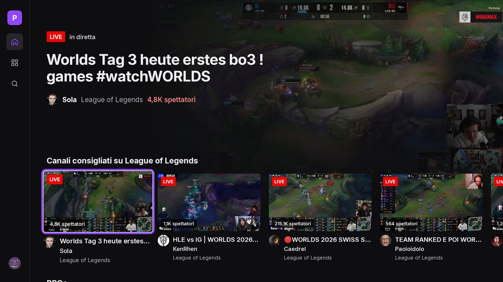
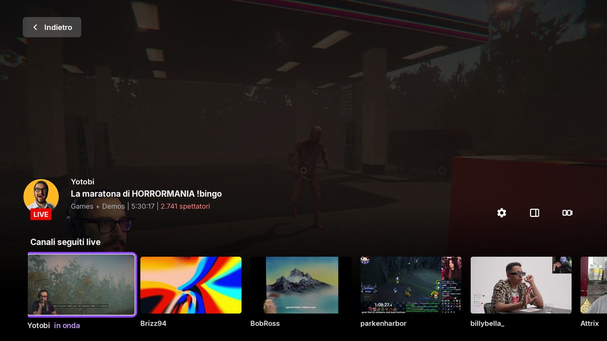
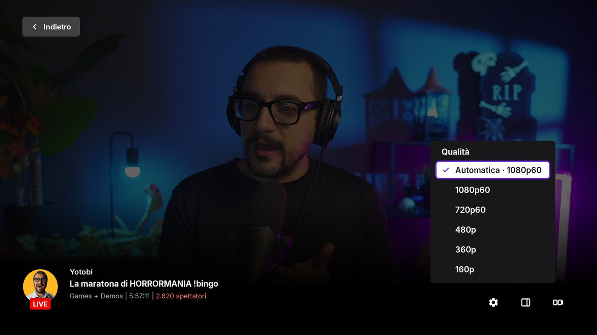
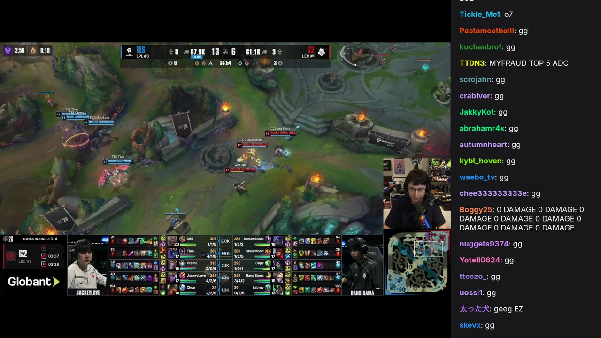

# Purple TV

A Twitch client for Android TV that plays 1080p60 streams smoothly on old, slow TVs.



I built Purple TV for my Sony KD-55XE9005, a 2017 TV with Android TV 9 and 2 GB of RAM. On that TV
the official Twitch app showed 1080p60 streams at about 28 frames per second. Purple TV plays the
same streams at 60 and uses about a third of the CPU.

The official app draws the video inside a web page, so the TV's GPU has to redraw every frame
together with the rest of the interface, and an old GPU can't keep up. Purple TV plays the stream
with Media3 ExoPlayer on a [SurfaceView](https://source.android.com/docs/core/graphics/arch-tv). The
hardware decoder writes the frames into it, and on a TV with a separate video plane, like mine, they
reach the screen without passing through the app's graphics.

Purple TV is an unofficial client and isn't affiliated with Twitch. It doesn't block or skip ads.

## What it does

- The home screen shows the live channels you follow, then the same recommendation rows as Twitch's
  TV app. The focused channel fills the top of the screen with its picture, title, game and viewers.
- Browse and search cover categories and channels. Before you type, search shows your recent
  searches and some categories you might like.
- Following has Live, Categories and Channels tabs. It shows followed live streams, followed
  categories with live streams, and all followed channels in alphabetical order.
- A followed channel opens a page with Watch Live, past-stream videos and top clips. Clips can be
  filtered to 24 hours, 7 days, 30 days or all time. Videos and clips play in the app with seeking
  and quality selection; past-stream videos remember their position on this TV for each account.
- Follow a category from its page or a channel from its page or the live player's heart button.
  Existing follows show as Following, and new follows appear when you return to Following.
- In the player, any key brings up an overlay with the quality menu, the chat and a Channels button.
  Channels opens a strip with the rest of the row you came from, so you can switch channel without
  going back to the home screen.
- The chat is read-only and sits beside the video. Names too dark to read on the panel are lightened.
- While a channel loads, its thumbnail stays on screen instead of a black frame, and an offline
  channel gets its own page with followed channels that are live.
- Back takes you to the home screen before it closes the app, and signing out asks for confirmation.
- The interface is in English, with an Italian translation.

<p>
  
  
</p>
<p>
  
</p>

The screenshots show the Italian translation.

## Install

Download the APK from the [latest release](https://github.com/smokills/purple-tv/releases/latest) and
install it on the TV, either with an app that installs APKs or with ADB:

```bash
adb connect <tv-address>
adb install -r purple-tv-<version>.apk
adb shell cmd package compile -m speed -f com.purpletv
```

The last command is optional. An app installed from a computer runs slower until Android compiles it,
which usually happens overnight.

Purple TV has only been tested on a Sony Bravia with Android TV 9. To build it yourself, see
[docs/development.md](docs/development.md).

## Sign in

On first start the TV shows a code. Open twitch.tv/activate on your phone or computer and type it in,
or scan the QR code next to it, which opens the page with the code already filled in. The page says
you're authorizing Twitch's TV app. That's expected, because Purple TV signs in the same way. The
login is stored on the TV and only sent to Twitch.

## How it works

Purple TV is a native Android app written in Kotlin with Android views. ExoPlayer plays Twitch's HLS
streams, OkHttp handles the network, Coil loads the images and ZXing draws the QR code.

Followed channels, video and clip listings, and search come from Twitch's official Helix API.
Playback addresses, followed categories and the home screen's recommendation rows come from
Twitch's undocumented GraphQL API, so a change on Twitch's side can break them without notice.

## Measurements

The same 1080p60 stream on the same TV, with about 70 seconds of `dumpsys SurfaceFlinger --latency`
for each app, in October 2026:

| | Official app | Purple TV |
|---|---|---|
| Frames per second on screen | 27.9 | 60.0 |
| Frames shown late | 22.6% | 0.9% at most |
| Stutters over 80 ms | 38 | 0 |
| App CPU | 74% | 24% |

A two-hour stream later played at about 60 fps from start to finish. The home screen measurements and
the commands to repeat them are in [docs/development.md](docs/development.md).

## Limits

- Ads play as they do in Twitch's own apps. Purple TV doesn't block, skip or hide them.
- Unfollowing is not available in the app, and the chat is read-only.
- Recorded playback has no chat replay. Saved video positions stay on this TV and do not sync to Twitch.
- Twitch can change its undocumented API at any time and break the app.

## License

Purple TV is released under the [MIT License](LICENSE). The bundled Inter font is under the SIL Open
Font License (`app/src/main/res/raw/inter_ofl.txt`).
